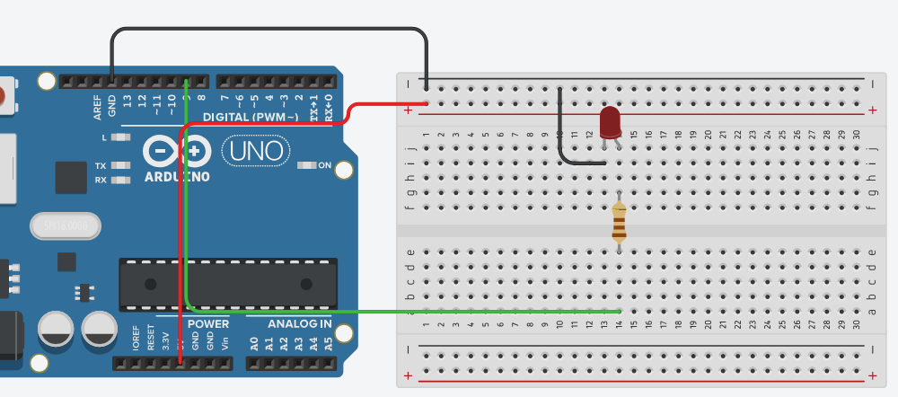

# Relazione tecnica - Controllo della luminosità di un LED mediante PWM

## Obiettivo

Controllo della luminosità di un LED mediante PWM.

## BOM (Bill of Materials)

- Arduino Uno R3
- 1 diodo LED
- 1 resistore da 220 ohm
- Jumpers

## Circuito



[Link alla simulazione Arduino](https://www.tinkercad.com/things/hJ0taRixAe0-2026-10-14-esercitazionepwm?sharecode=rBHUbySZ0d-Kyxzkz4yGtaLbYuAzG_OOnz8UdPDL4rw)

## Collegamenti

- LED: pin `D9` -> resistore -> anodo del LED; catodo a `GND`.

## Funzionamento

Il programma utilizza la funzione `analogWrite()` per impostare, sul LED collegato al pin PWM `D9`, un'intensità proporzionale al valore della variabile `brightness`. Il valore di `brightness` può variare da 0 a 255: 0 corrisponde al LED spento, mentre 255 corrisponde alla massima luminosità.

Ad ogni iterazione del ciclo `loop()`, il valore di `fade_amount` viene sommato a `brightness`. Inizialmente `fade_amount` è positivo, quindi la luminosità aumenta gradualmente da 0 verso 255. Quando `brightness` raggiunge il limite superiore, il programma inverte il segno di `fade_amount`; di conseguenza, nelle iterazioni successive `brightness` diminuisce e il LED diventa gradualmente meno luminoso.

La condizione:

```cpp
if (brightness <= 0 || brightness >= 255)
    fade_amount = -fade_amount;
```

utilizza l'operatore `||`, che rappresenta l'OR logico. La condizione è quindi vera quando `brightness` è minore o uguale a 0 oppure maggiore o uguale a 255. In entrambi i casi `fade_amount` cambia segno: quando la luminosità raggiunge uno dei due estremi, il LED inizia a variare nella direzione opposta. Questo processo si ripete continuamente, producendo un aumento e una diminuzione graduali della luminosità.

**Autore:** Ignazio Leonardo Calogero Sperandeo

by jimbug // :)