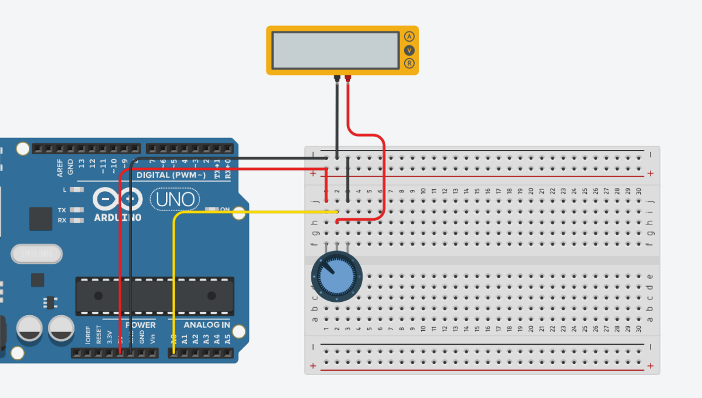

# Relazione tecnica - Misurazione della tensione di un potenziometro

## Obiettivo

Misurare la tensione in uscita da un potenziometro e controllare la frequenza di lampeggio del LED integrato di Arduino.

## BOM (Bill of Materials)

- Arduino Uno R3
- Voltmetro o multimetro
- Potenziometro
- Jumpers

## Circuito



[Link alla simulazione Arduino](https://www.tinkercad.com/things/aatgaTU9lTf-2026-10-14-esercitazionepotenziometro?sharecode=9VSyvcSaWcZFiDXdov-395C71Vjpqmv5ijsiXPDGv1k)

## Collegamenti

- Potenziometro: un terminale esterno -> `GND`, l'altro terminale esterno -> `5V`, wiper -> `A0`
- Multimetro: collegato tra wiper e `GND`.

## Funzionamento

Il programma verifica come la rotazione del potenziometro modifichi la tensione in uscita dal wiper rispetto a `GND`. La funzione `analogRead()` legge la tensione presente sul pin `A0` e restituisce un valore compreso tra 0 e 1023, perché il convertitore analogico-digitale di Arduino Uno utilizza una risoluzione di 10 bit.

Il valore restituito da `analogRead()` viene utilizzato per calcolare la tensione mediante la formula:

```text
voltage = sensor_value × VCC / (2^n − 1)
```

Nel caso di Arduino Uno, con `VCC = 5 V` e `n = 10`, la formula diventa:

```text
voltage = sensor_value × 5 / 1023
```

Il valore calcolato viene quindi visualizzato sul monitor seriale. Infine, il LED integrato di Arduino lampeggia utilizzando come durata del `delay()` il valore letto dal potenziometro. Di conseguenza, con valori analogici più elevati il LED lampeggia più lentamente, mentre con valori più bassi lampeggia più velocemente.

**Autore:** Ignazio Leonardo Calogero Sperandeo

by jimbug // :)